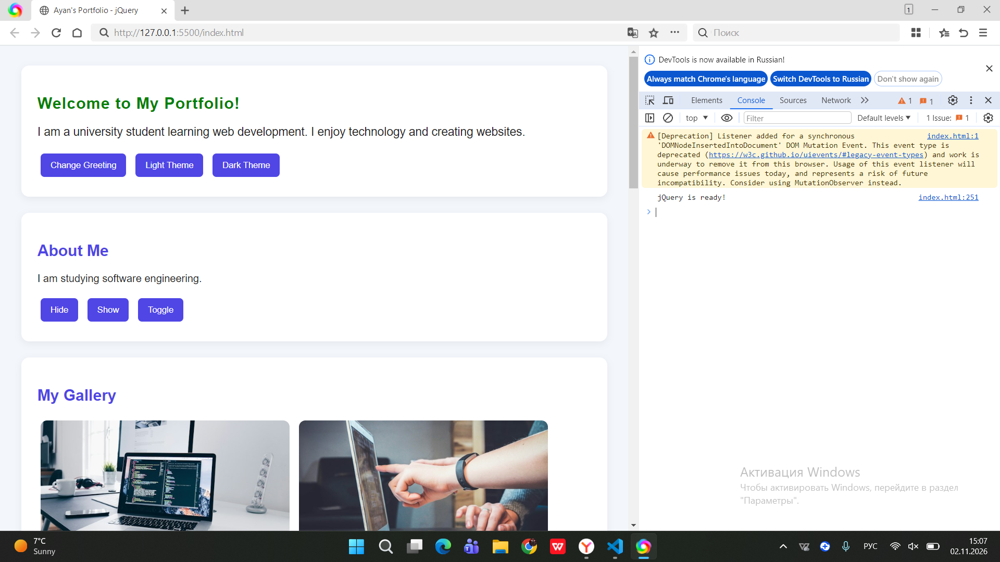
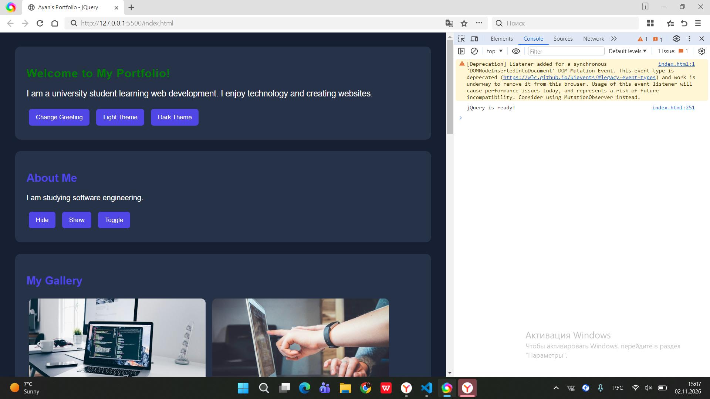
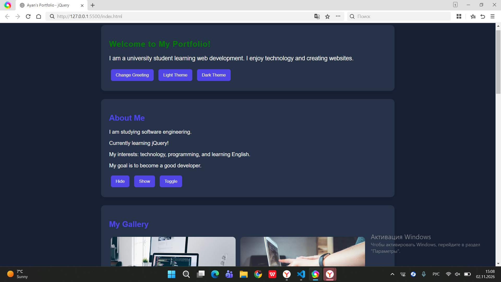
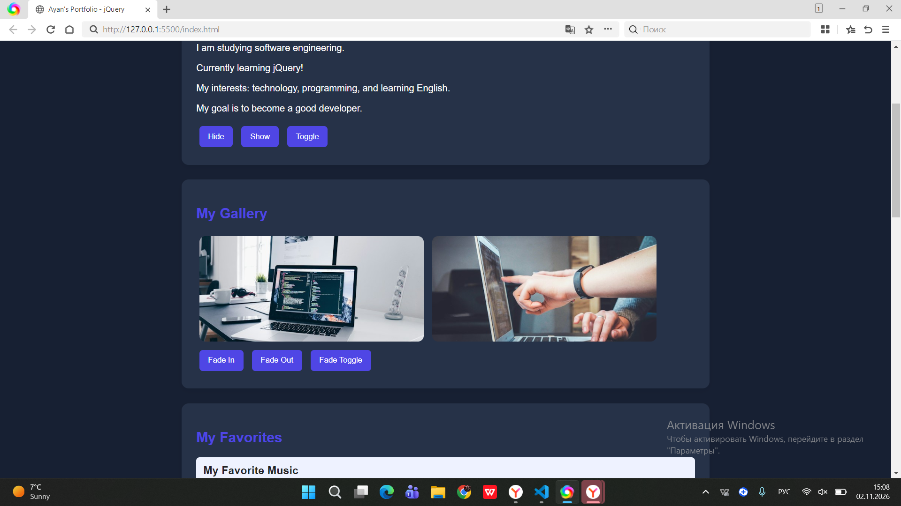
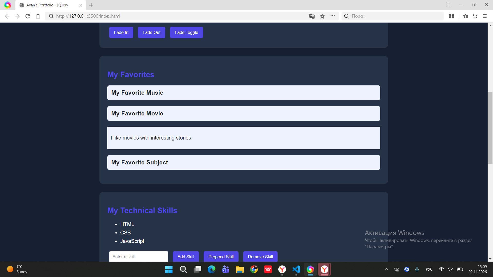
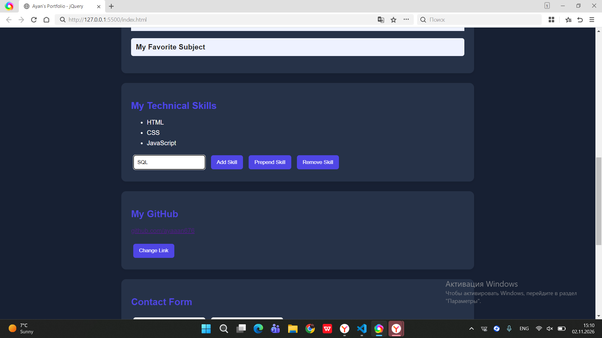
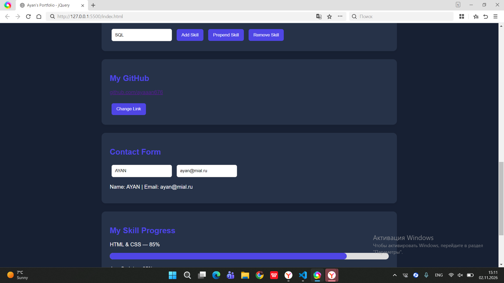
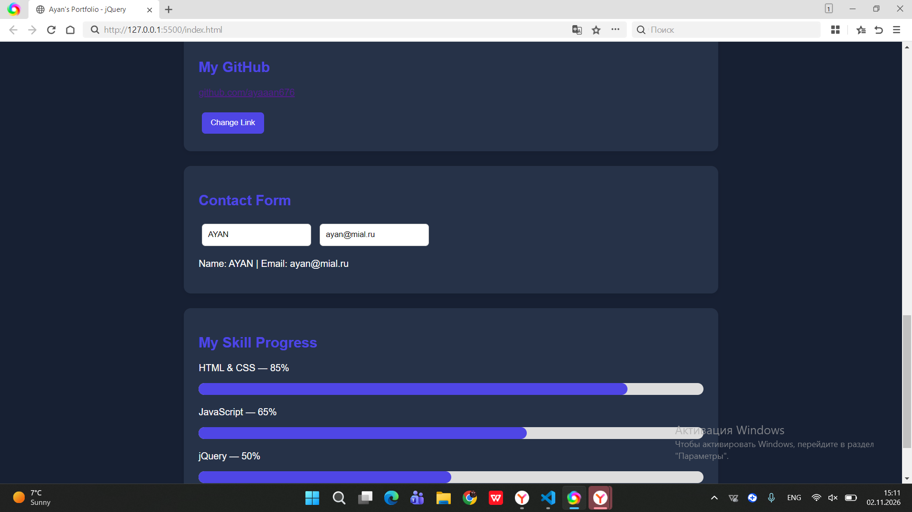
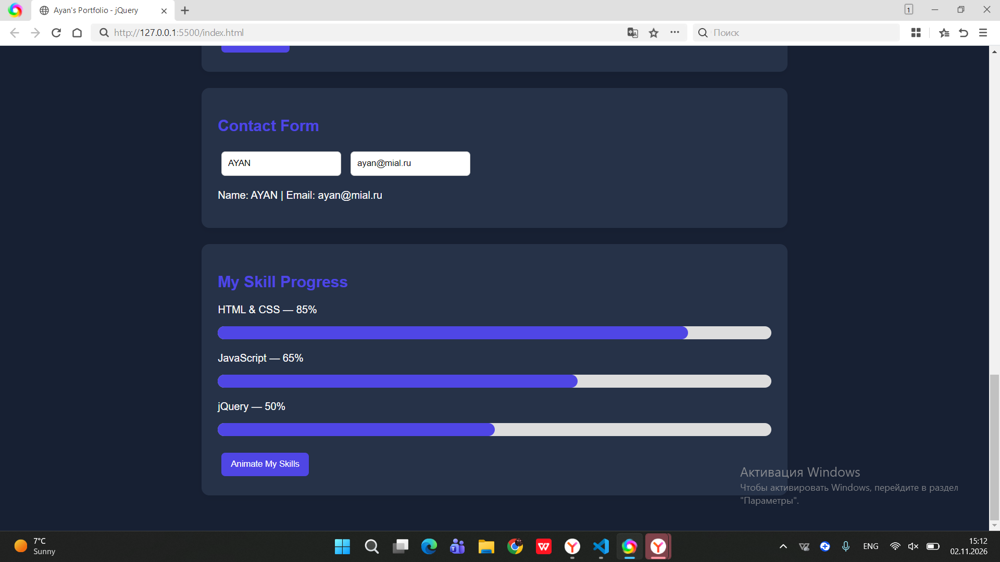

# Assignment 6 — jQuery

**Student:** Ayan Sarbasov  
**Group:** SE2538  
**Course:** Web Technologies

## Project Description

This project demonstrates the use of jQuery selectors, events, effects, and animations. It is a simple interactive personal portfolio website.

## Tasks Completed

### Task 0 — jQuery Setup
- Added jQuery using CDN.
- Used `$(document).ready()`.
- Displayed a message in the browser console.

### Task 1 — Selectors and CSS
- Used tag, ID, and class selectors.
- Updated text and HTML content.
- Changed CSS styles.
- Added Light and Dark theme buttons.

### Task 2 — Hide, Show, and Toggle
- Created an About Me section.
- Added Hide, Show, and Toggle buttons.

### Task 3 — Fade Effects
- Added images.
- Used `fadeIn()`, `fadeOut()`, and `fadeToggle()`.

### Task 4 — Slide Effects
- Created interactive panels.
- Used `slideUp()`, `slideDown()`, and `slideToggle()`.

### Task 5 — Dynamic Skills List
- Created a skills list.
- Added new skills using `append()` and `prepend()`.
- Removed skills using `remove()`.
- Prevented empty input.

### Task 6 — Attributes
- Used `attr()` to change a social media link.

### Task 7 — Form Preview
- Created a Name and Email form.
- Used `val()` and `text()` to display live preview.

### Task 8 — Animations
- Created animated skill bars.
- Used `animate()` to change their width.

## Project Links

- **GitHub Repository:** https://github.com/ayaaan676/assignment6_jquery_ayan
- **Live Website:** https://ayaaan676.github.io/assignment6_jquery_ayan/

## Screenshots

Screenshots of the completed tasks are included in the `screenshots` folder.

## Conclusion

In this assignment, I learned how to use jQuery selectors, events, effects, and animations to make a website more interactive.